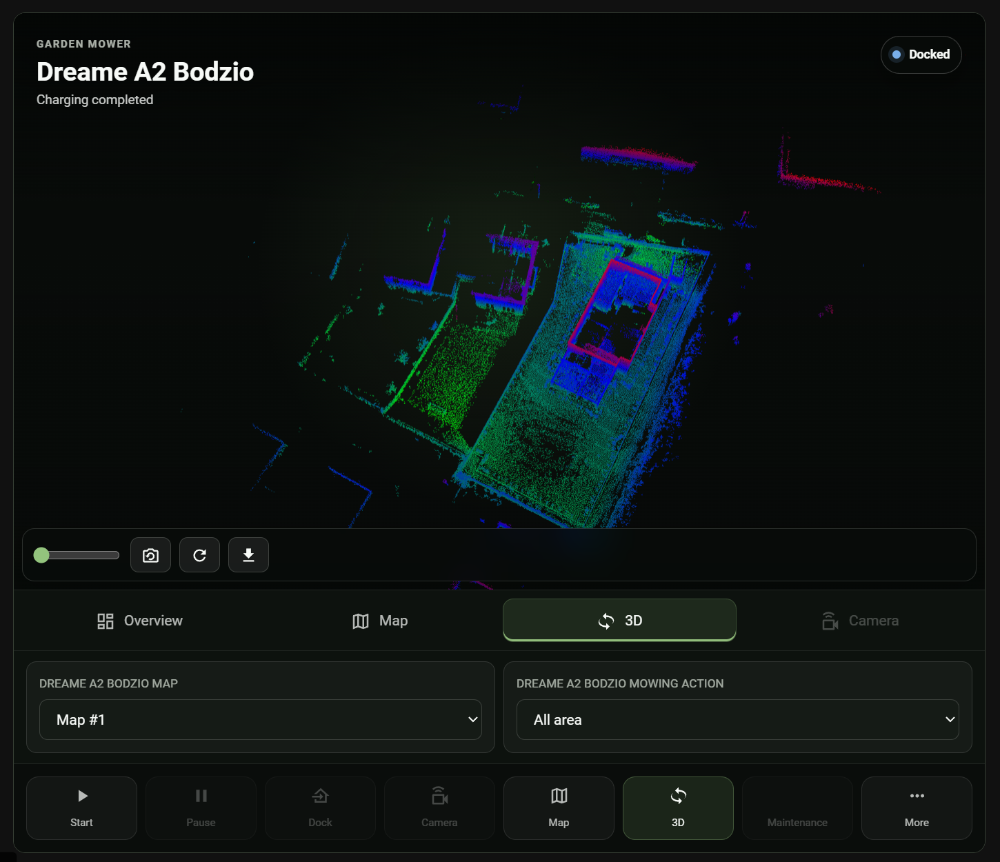

# Maps and 3D

[Back to the README](../README.md) · [Configuration](configuration.md)

Use the enabled **Map** camera for everyday dashboards. Choose the same camera
in Lawn Mower Card for the interactive view, and open **3D** only when you want
to load a point cloud. Map editing is not supported.

## Map cameras

The map camera uses the confirmed app-map JSON path first and falls back to the
vector source when it carries the active session. Both renderers use the same
palette, bundled Unicode font, path widths, and marker settings.

The primary `Map` camera is enabled by default and follows the current mowing
session, including the mower position and live path when the device reports
them. `Live Path Map`, `All Maps`, and `Map Diagnostics` remain optional,
disabled-by-default cameras for troubleshooting or specialized dashboards.

Live positions and runtime trails also work when the mower supplies only an
app-action map, including A1 Pro models without batch vector maps. The map must
match the current app slot and pass hash verification before it can validate
runtime coordinates. The Map camera, Live Path Map camera, interactive overlay,
and runtime track sensors share that geometry. Stale or unscoped telemetry does
not establish a live position or trail; retained positions keep their status.

When the mower announces a map switch made in its app, Home Assistant expires
the previous map identity and refreshes the map inventory after a short settling
delay. If the map list still reports the preceding map, bounded readback retries
give the mower more time to finish switching. Paired switch announcements share
the background refresh. A response started before the announcement cannot
restore the old map's live tracking or mark its map, 3D object, schedule, or
preference metadata as freshly read. Camera renders and dashboard scenes also
discard results from before the announcement, even when the map number stays
the same. Live overlays wait for a new geometry observation; the dashboard scene
waits for the refreshed inventory. The destination map comes from the mower's map
inventory, never from the announcement itself.

A failed batch-map request does not discard a verified app map or its live
overlay. App-map downloads accept up to 4 MiB and 16,384 chunks per map, with a
16 MiB total byte budget and one 60-second budget shared across map selection,
downloads and retries. A download that exceeds these limits is reported as
unavailable and does not supply live geometry.

Locally rendered vector maps hide saved spot-mowing rectangles by default and
draw completed mowing passes subtly. This keeps the everyday map close to the
vendor app while preserving the live route and mower marker. The source spot
and path data remains available in map diagnostics.

Enabled map cameras warm their first image in the background during entity
startup. While a mowing session is active, coordinator updates also refresh the
map source without waiting for a browser request. An empty cache returns a loading
image while the download runs, keeping camera requests responsive. The camera returns the
last good JPEG for the same map immediately while a refresh runs. Switching maps
discards the previous lawn's image. Failed current-map downloads are retried once;
they do not silently substitute another saved map. Identical source images reuse
the existing JPEG conversion, and requested image sizes use a bounded cache of
resized JPEGs.

## Geographic alignment and derived location

Lawn Mower Card can align the mower map with a street or satellite background.
The integration stores each calibration against the verified current map slot
and revision. Switching maps uses that map's own calibration; replacing a map
requires a new alignment. Saving or clearing a calibration keeps the mower
connection running.

The `dreame_lawn_mower.set_georeference` action accepts native `anchor_x` and
`anchor_y`, the anchor's `latitude` and `longitude`, `heading` (the compass
direction of the native +Y axis), and `scale` in metres per native unit (default
0.001). `dreame_lawn_mower.clear_georeference` removes the current map's
calibration. Editors can supply `map_index` and `map_revision` to either action
to reject a save or clear after the map changes.

The **GPS position** device tracker projects a validated current mower position
or a confirmed docked station through this calibration. Its coordinates are
derived from the map and manual alignment; they are not a separate onboard GPS
measurement, and no measured accuracy bound is available. Last-known history,
unverified maps and calibration from another revision do not publish a current
geographic position. The tracker exposes the position's evidence status and
when that evidence was first observed.

A mower confirmed docked after a Home Assistant restart can use its verified
current-map station even without a live telemetry session. This does not admit
unverified live poses or restore a stale mowing trail.

## Saved previews

Map images stay in memory by default. To keep a preview through a Home Assistant
restart, enable **Keep a map preview across restarts** in the integration options.
This stores one private JPEG, up to 2 MB, for at most 24 hours of reuse. It is
accepted only for the same mower, map, and presentation settings. The camera marks
it with `restart_preview: true` and a saved timestamp; it does not restore live
position or mission telemetry. The companion Lawn Mower Card labels it **Saved
preview** until a fresh map replaces it. Disabling the option removes the stored
preview.

A map-switch announcement also retires the saved preview, including when the
primary camera entity is disabled. Pending writes finish before the retired
image is removed. The first verified image after a same-slot switch replaces
the preview immediately; later updates retain the usual write cooldown.

Transient paths are scoped to the selected map and mowing task.
Changing either clears the prior session trail. A mower position outside the
selected map boundary is retained in diagnostics but withheld from the image,
and persisted mower trail data is not presented as live while the session is
inactive.

## Interactive map

The primary map camera also exposes `mowing_map_api_path` for compatible versions
of [Lawn Mower Card](https://github.com/EvotecIT/lovelace-lawn-mower-card). This
read-only interface delivers the garden background separately from current
position and observed movement, so a moving marker does not require downloading
another full map image. The card can pan, zoom, fit the garden, and centre on a
fresh mower position while keeping battery and mission figures visible.

The interface requires the same read permission as the map camera. Geometry is
kept out of entity attributes and recorder state. A missing map identity or stale
position does not produce a live marker. Movement trails are not cut-area masks:
the interactive background omits historical mowing paths and decorative stripes
instead of presenting them as verified completed coverage.

When fresh coordinates stop arriving, a compatible card can show a muted
**Last known position** for up to 24 hours. **At dock · observed position** requires
a valid position received while the mower is confirmed docked or charging;
that observation can be reused for up to seven days while it remains docked.
Both positions are tied to the map geometry and retain their observation time.
The bounded observation checkpoint can retain them across an integration
restart, but fresh map geometry must match before they are displayed. Restored
evidence never becomes a live position or restores an old movement trail.

Finished task summaries can also report the charging station through a `dock`
coordinate. When the summary's revision matches the unique verified current map,
the camera and interactive background show a small station marker. Camera
attributes `charger_x` and `charger_y` use the same native units as mower positions.
A station from another revision is never substituted, even when its coordinates
fit inside the lawn's bounds.

While the mower is confirmed docked and the current map frame remains valid, its
marker uses the reported station and `position_source` is
`reported_charging_station`. This position is assessed from the current docking
state; it does not become a saved telemetry observation. Station reports are kept
in the bounded recent-session cache and selected again when maps change.

Charging alone does not supply coordinates. Without a matching station report or
valid saved dock observation, position-free heartbeats show **Docked · map position
unavailable**. The integration does not use a maintenance point or the last route
endpoint as an invented dock location. Camera attributes expose `position_status`,
`position_source`, and `position_observed_at` for the same evidence.

## Appearance and rotation

Under **Settings → Devices & services → Dreame Lawn Mower → Configure**, choose
an Emerald, Mint, Dark, Midnight, or High contrast theme and adjust label, line, and
marker scale. **Saved spot area display** can hide spot rectangles, show only
their outlines, or restore the filled diagnostic overlay. **Completed mowing
path display** can hide previous passes, render them subtly, or show every pass
in full detail. These settings affect both app-map and vector-map rendering and
apply without reconnecting the integration. Scan-interval changes also apply
without a reload. Connection, video, and restart-preview options still reload
the integration when their values change.
Mint uses decorative stripes clipped to each lawn; the stripes do not indicate
mowing progress or direction. Connector paths remain open and are never filled
as extra lawns. Use **Selected Map Display Rotation** to store a different
rotation for each map, with upright labels in locally rendered maps and the
All Maps contact sheet. To use a custom mower marker, place a PNG, JPEG, or WebP
under `/config/www` and enter its relative path, such as
`mower/my-marker.png`. The integration ignores absolute paths, traversal,
unsupported types, files over 1 MB, and images larger than 512 by 512 pixels.
Use a top-down image with the mower's nose pointing upward. In locally rendered
maps, the image keeps its aspect ratio and follows the current reported heading
and the selected map rotation. In vector maps, an unknown heading or last-known
position keeps the image in its original orientation. The heading describes
where the mower faces; reversing can move it in the opposite direction.
The same picture also appears on the
[Lawn Mower Card](https://github.com/EvotecIT/lovelace-lawn-mower-card)'s interactive
map without a second image setting (requires a card version with custom-marker
support).

### Real-scene background

Set **Map background** to **Real-scene photo** to draw the mower's top-down
garden photo under the lawns, the live position and the trail of the Map and
Live Path Map cameras, as the vendor app's Real-scene Map does. Lawns become
translucent and Mint stripes are not drawn while the photo is shown. The photo
follows the selected map's display rotation.

The camera asks the mower for the photo name with a read-only app request
(`{"m": "g", "t": "OBJ", "d": {"type": "ARmap"}}`), outside the map refresh,
at most every 30 minutes or when the selected map changes. The mower updates
the photo after a task, and the PNG is downloaded only when its name changes.
The name carries the placement, for example `..._275_202_3cm_processed.png`:
the image origin in pixels and the ground size of one pixel. When the mower
publishes no photo for the selected map, the standard background is used. The
All Maps and Map Diagnostics cameras always use the standard background. The
interactive map scene advertises the photo as a separate layer: its JSON adds
`real_scene_path`, a PNG with the same width and height as `background_path`,
drawn in the same canvas so a card can stack it under the transparent
background. The field is `null` when no photo is available.

This was verified on a MOVA LiDAX Ultra 1000 (`mova.mower.g2529c`), where the
lawn contour matched the photo. Other models may not publish a real-scene photo.

## Mission values after docking

The runtime mission progress, current-area, and total-area sensors also retain
the latest useful session values after mowing stops. While mowing they represent
live telemetry; after docking their attributes include `cached: true` and
`captured_at`. They become live again as soon as a new runtime session reports
metrics. This keeps dashboards useful without presenting an old mower position
or trail as current.

If the mower has multiple maps, enable the disabled `All Maps` camera to render
a contact sheet. Use `Map Diagnostics` when the map image is missing or when you
need source, counts, and parser evidence.

## 3D point clouds

The map camera also advertises a local `point_cloud_api_path` attribute. A
Home Assistant administrator can sign that path for a short-lived download.
For the active map, the integration first tries a stored LiDAR object whose map
index is confirmed by the app inventory or mower `OBJ` response. A mower with
exactly one created map may also reuse the vendor's `99.20` stored-object
announcement. That announcement has no map identity, so it is never reused on
a multi-map mower. If no safely attributed stored object is available, the
integration asks the mower to upload the selected app map, captures the new
announcement, and validates the returned PCD file. Firmware without the
announcement retains the older indexed-object lookup as a fallback. Responses
use short-lived private caching; forced refreshes use `private, no-store`.
Vendor filenames, cloud-signed URLs, and point coordinates are never written to
entity state or logs.

The companion
[Lawn Mower Card](https://github.com/EvotecIT/lovelace-lawn-mower-card) detects
this attribute and offers an on-demand 3D viewer. It does not generate or
download garden geometry during an ordinary dashboard render. Select the Hero
layout's **3D** tab or press **Load 3D map** in another layout when you want to
fetch it. The route itself does not prove mower support: `feature_capabilities.point_cloud`
reports `supported`, `unknown`, or `unsupported`, with its evidence source.
A2 and MOVA LiDAX Ultra 1000 have confirmed model support. The LiDAX export was
field-confirmed with a US account on firmware `4.3.6_0529`. Other models remain
unknown until explicit metadata or a validated download supplies evidence;
LiDAR and 2D maps alone do not. The current companion card asks for an explicit
load on unknown mowers.
Point-cloud access is currently restricted to Home Assistant admins.
A safely attributed stored file normally avoids mower generation; otherwise the
mower has up to 45 seconds to publish a fresh file. A failed request returns a
privacy-safe problem code and stage instead of exposing the vendor object name
or signed download URL.

This Dreame A2 view uses a real stored PCD from the integration, rendered by
Lawn Mower Card:



## Map controls and limits

Map controls include:

- a read-only `Map` camera for the active map
- a read-only `All Maps` contact sheet for quick map inventory
- a `Map` select that switches the mower's active map and refreshes the map,
  zone, spot, edge, and maintenance-point controls
- a `Selected Map Display Rotation` select that stores orientation per map
- `select` entities for mowing action, edge, zone, spot, and maintenance-point
  scope
- preference controls that follow either the selected map's global record or
  its selected custom zone
- a **Go to Maintenance Point** button when the selected map contains a point
  configured in the mower app
- services for switching the active mower map and starting explicit zone, spot,
  or edge jobs
- runtime live-track telemetry surfaced through sensors and map-camera attributes
- an admin-only, stored-or-fresh PCD point-cloud download for the selected app map
- circular and rotated rectangular forbidden areas rendered from their compact
  mower map representation

The mower acknowledges map-switch commands even when it ignores them during an
active, paused, or returning task. The integration blocks those states before
writing and does not change the selected map until `MAPL` confirms the requested
map index.

Interactive map editing is still intentionally out of scope for now:

- no-go editing
- virtual-wall editing
- zone geometry edits
- other direct map mutations

## Read-only backup inspection

The Python client can inspect a backup map through the app's indexed `MAPBI`
and `MAPBD` getters. It verifies the payload hash and keeps the existing byte,
chunk and timeout limits. Backup reads share the active-map transaction lock
but never replace the active map's cache or selected-map identity.

```python
backup = await client.async_get_app_backup_map(0)
```

The result contains verification and geometry counts. Raw geometry is included
only with `include_payload=True`. With the existing account environment configured,
the diagnostic example supports the same operation:

```bash
python examples/app_map_probe.py --backup-index 0 --out backup-map.json
```

This inspects a backup; it does not restore it. Availability depends on the
mower's firmware. The transport and integrity paths have regression coverage;
backup inspection is not claimed as field-validated on every supported mower.
